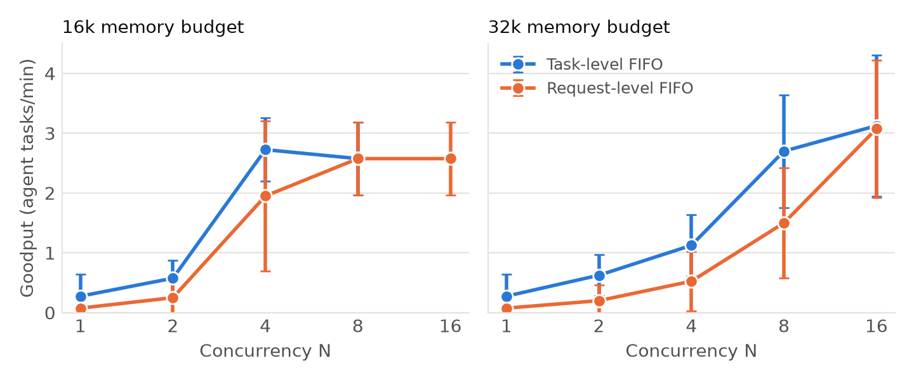
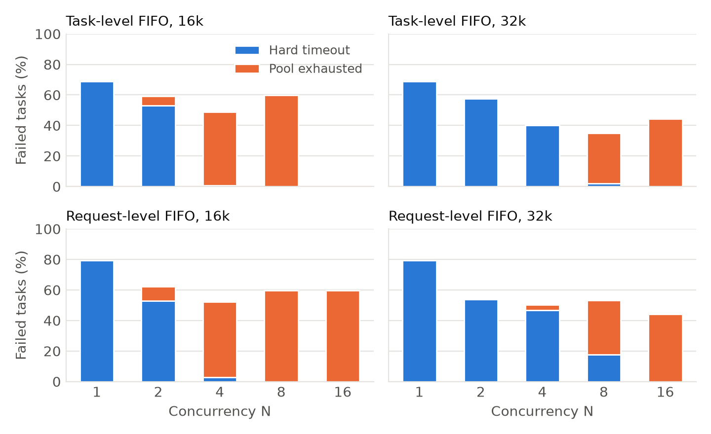
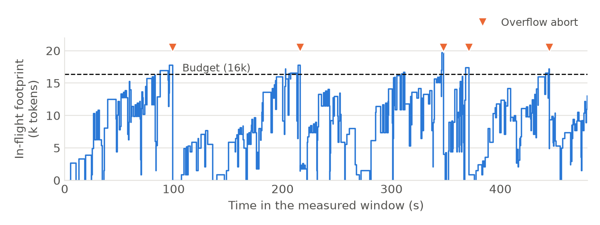
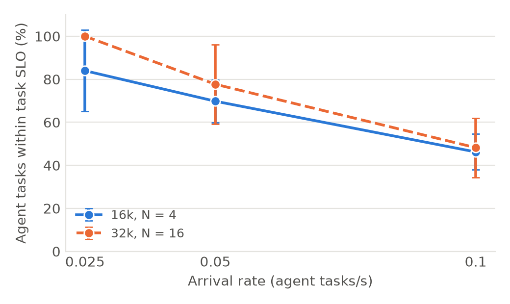

# Memory-Aware Agent Serving: Phase 1 Report

**CSE 291A, Fall 2026, Option 1.** Zhe Kan. *Draft.*

## Abstract

Agent workloads issue chains of dependent model requests whose context grows at every step. We ask how a serving system should admit that work when its memory is bounded, and start by measuring what simple policies do on an unmodified llama.cpp server. We analysed 200 sweep runs of two FIFO baselines with fixed concurrency across concurrency, memory budget, arrival rate and cache policy, repeating every configuration with five seeds.

Three findings shape Phase 2. First, memory pressure here is not gradual: when running requests together overflow the server's KV-cache pool, nearly all of them fail at once. At the best tuned setting on a 16k-token budget, this happened 6.4 times per 8-minute run, while the mean admitted footprint was only 52% of the budget, and 63% of recorded output tokens belonged to agent tasks that eventually failed. Second, neither tuning concurrency nor doubling the budget removes the problem, and offloading idle context to host RAM showed no clear benefit under the tested conditions. Third, retained context is essential: disabling it cuts goodput about 5×. The footprint the proxy can compute before admitting a request exceeded the budget ahead of 145 of 146 overflow events. We therefore propose footprint-based admission for Phase 2. Its gains are likely to be largest at 0.025–0.05 agent tasks/s, where memory is the binding limit. At 0.1 agent tasks/s, the measurements suggest compute pressure may limit any gains, but we have not measured sustained serving capacity directly.

## 1. Introduction

An agent task alternates between model requests and tool calls, and each prompt carries everything before it. On a memory-constrained machine this creates a tension: admitting too much can exhaust memory, while admitting too little leaves capacity idle during tool delays.

This phase establishes a reproducible baseline and answers four questions:

1. How do concurrency, context growth and memory budget affect memory pressure and completed work?
2. Does retained context materially affect this runtime?
3. What is the dominant bottleneck, and at what load?
4. Which single mechanism does the evidence justify building in Phase 2?

## 2. Related work

Serving systems for language models have made memory and scheduling first-class concerns. Orca introduced iteration-level scheduling so requests can join a running batch [2]. vLLM allocates KV cache on demand in blocks and preempts requests when memory runs out, by swapping them out or recomputing them later [1]. Sarathi-Serve bounds the stall that prompt processing imposes on running requests [3]. SGLang shares KV cache across requests with a common prefix [4].

Agentix treats agent programs as the scheduling unit and uses their previously completed calls to prioritize dependent LLM requests [8]. Our study focuses on admission under a bounded KV pool using an external proxy over an unmodified runtime.

llama.cpp's server, the runtime the course points to, makes different choices [6]. Reading its source and probing it (Section 3.1) shows it counts slots rather than memory, and it cannot pause a running sequence. That combination makes overload especially costly, and it means an external admission layer is the natural place to add memory awareness without changing the runtime.

## 3. Method

### 3.1 System and runtime behaviour

The harness has a workload generator, an asyncio proxy that runs a pluggable admission policy, an unmodified `llama-server`, and a recorder. The memory budget is the token capacity of the server's shared KV-cache pool (`--kv-unified`). We control it directly and measure physical memory as an outcome, because the server reserves the pool at launch, so a byte limit would mostly make it fail at startup.

A pilot established the behaviour everything else depends on, at the pinned release. The [pilot findings](../pilot/pilot-findings.md) record the probes and logs; the server source at the pinned commit is linked in [6]:

- Admission counts slots only. It never checks whether a sequence will fit.
- When the pool fills, the server deletes one idle slot's KV and retries, then halves its batch size.
- If that still fails, **every running sequence fails** with HTTP 500 and loses its KV. We call this an **overflow abort**. The server stays up, and queued requests still run.
- A request whose prompt plus output exceeds the pool returns HTTP 200 with shortened output. The harness treats this as a failure.
- The server does not report KV occupancy, so the proxy tracks footprints itself.

### 3.2 Workload

Workloads are synthetic so that the experiment controls token counts exactly. Each agent task belongs to one of eight task classes: short or long starting context (500 or 4,000 tokens) × short or long output per step (50 or 400) × few or many steps (2–3 or 8–12). Each step adds its output plus a 200-token synthetic tool result, so final context ranges from about 750 to about 11,000 tokens. Tool delays are log-normal with a 1 s median. Arrivals are open-loop Poisson, so overload appears as queueing instead of being hidden by clients slowing down [11].

Prompts are token arrays, and each step's prompt is an exact extension of the previous one, so measured prefix reuse reflects the runtime and not tokenizer drift. Output lengths are fixed (`n_predict`, EOS ignored), which means no policy can look better by producing shorter outputs. We checked the parameters against 500 public SWE-agent trajectories [5][7] (median 16 steps, about 1.9k starting tokens, 79 output tokens per step). These are our sample statistics, computed by [trajectory_stats.py](../../scripts/trajectory_stats.py); the [workload analysis](../workload.md#justification-against-public-trajectories) documents the sampling method. Tool delay has no empirical basis, because the dataset has no timings.

### 3.3 Baselines and configurations

- **Task-level FIFO:** an agent task holds one of N slots from arrival to completion, tool delays included.
- **Request-level FIFO:** each model request queues on its own with at most N in flight, and a task re-queues after each tool delay.

We tuned each baseline by goodput over N ∈ {1, 2, 4, 8, 16} at a rate of 0.1 agent tasks/s, with a fixed selection rule (highest mean goodput, ties to smaller N). We then ran the best N for each baseline and budget across rates. Cache policies were **resident** (context stays in the pool, tasks pinned to slots), **offload** (idle context moves to host RAM, tasks unpinned) and **off**.

### 3.4 Protocol and metrics

Each sweep run has a 60 s warm-up (recorded but excluded), 8 minutes of measured arrivals and a drain, on a freshly started server. Each configuration uses five seeds; we report means with 95% confidence intervals (Student's t). Nothing is retried silently.

**What is counted, and over what period.** A run's metrics cover the agent tasks that *arrive* during the 8-minute measured window. Each of those is followed through the drain to its outcome: completion, failure or hard timeout. Throughput and goodput are the number of those tasks that completed, or completed within their SLO, divided by the length of the arrival window (8 minutes). Completions that happen during the drain count; tasks that arrive during warm-up or drain do not. Peak memory, KV occupancy and policy overhead cover the same tasks' whole lifetime, through the drain.

**Which tasks each metric includes.** Failed tasks count as agent tasks in failure rate and SLO attainment, and their model requests count in queueing time. Completion-latency percentiles (p50, p95, p99), however, are computed over **completed agent tasks only**, because a failed task has no completion time. This matters when reading the tables. A configuration that loses its long agent tasks can show *lower* latency than one that finishes them, because the slowest tasks are missing from the sample. Latency should therefore always be read together with failure rate and the per-class breakdown (Section 4.5). Cached-token shares are likewise computed over successful model requests.

**Goodput**, the headline metric, counts agent tasks completed within their **task SLO** per minute. The SLO is 3× the task's unloaded completion time, measured by running it alone on one fixed reference setup (resident, caching on, 32k), so the yardstick does not vary with the configuration under test. A **failed task** is one in which a model request returned an error, or which was still unfinished at its **hard timeout**: 10× its unloaded completion time, measured from the task's arrival. The hard timeout therefore bounds the whole agent task, including queueing, every model request and every tool delay, not any single model request.

### 3.5 Environment and the machine change

The model is Meta's Llama-3.2-3B-Instruct [9], using bartowski's Q4_K_M GGUF artifact at revision `5ab33fa9` [10] (SHA256 pinned), on llama.cpp b11606 built from source at commit `1b70350c9` [6], on an RTX 2000 Ada (16 GB) RunPod pod.

The first pod's host failed partway through the sweep, so the experiments span two machines with the same GPU model but different cards, drivers and CPU quotas. We pooled results only after an explicit check. Re-running one configuration with the same seeds on machine B gave a median per-task unloaded-time ratio of 1.039 (p10 1.003, p90 1.050, 279 tasks) against a ±5% tolerance, with all six headline metrics inside machine A's 95% CI. Machine B is therefore consistently about 4% slower per task.

No configuration's seeds span machines, and each machine sets its own SLOs. Points compared across machines are marked † below. Tables mark the machine as A or B.

## 4. Results

### 4.1 Concurrency has two different failure modes



*Figure 1. Goodput against N at 0.1 agent tasks/s, resident. Bars are 95% CIs.*



*Figure 2. Failed tasks by cause at 0.1 agent tasks/s. N = 16 at 16k was run for request-level FIFO only.*

| Baseline | Budget | N | Mach. | Goodput/min | Throughput/min | Timeout % | Pool exhausted % | p50 s | Queueing s |
| --- | --- | --- | --- | --- | --- | --- | --- | --- | --- |
| Task-level | 16k | 1 | A | 0.28 ± 0.37 | 1.98 ± 0.30 | 69 ± 4 | 0 ± 0 | 359 ± 80 | 50.1 ± 7.4 |
| Task-level | 16k | 2 | A | 0.57 ± 0.30 | 2.62 ± 0.67 | 53 ± 6 | 6 ± 4 | 178 ± 29 | 26.9 ± 4.2 |
| Task-level | 16k | **4** | A | **2.73 ± 0.53** | 3.27 ± 0.82 | 1 ± 1 | 48 ± 9 | 20 ± 4 | 1.0 ± 1.2 |
| Task-level | 16k | 8 | A | 2.58 ± 0.61 | 2.58 ± 0.61 | 0 ± 0 | 60 ± 8 | 16 ± 5 | 0.0 ± 0.0 |
| Request-level | 16k | **8** | A | **2.58 ± 0.61** | 2.58 ± 0.61 | 0 ± 0 | 60 ± 8 | 17 ± 5 | 0.0 ± 0.0 |
| Task-level | 32k | 4 | A | 1.12 ± 0.51 | 3.85 ± 0.91 | 40 ± 8 | 0 ± 0 | 154 ± 26 | 15.6 ± 3.1 |
| Task-level | 32k | 8 | A | 2.70 ± 0.94 | 4.15 ± 0.79 | 2 ± 5 | 33 ± 5 | 35 ± 7 | 1.1 ± 1.8 |
| Task-level | 32k | **16** | B | **3.12 ± 1.18** | 3.60 ± 1.11 | 0 ± 0 | 44 ± 12 | 27 ± 5 | 0.0 ± 0.0 |
| Request-level | 32k | **16** | B | **3.08 ± 1.15** | 3.60 ± 1.11 | 0 ± 0 | 44 ± 12 | 27 ± 5 | 0.0 ± 0.0 |

*Table 1. Selected tuning results (bold: chosen N). The full grid is in `phase1-tables.md`.*

Small N fails by queueing: tasks wait until they hit their hard timeout. Large N fails by overflow. In between there is no setting that avoids failure: **even the best N fails about half of all agent tasks.** The best N is also a plateau rather than a peak. The confidence intervals of neighbouring settings overlap, so the selected values should be read as "tuning has run out", not as a precise optimum.

Latencies in Table 1 cover completed agent tasks only, so they must be read with the failure columns. Task-level FIFO at N = 4 and 16k reports a p50 of 20 s, well below the 65–79 s that a long-output, many-step task takes even when it runs alone (Table 4). Almost none of those tasks completed (Section 4.5), so they are simply missing from the latency sample.

Once N no longer binds, the two baselines behave identically, because queueing is zero and the limit is never reached. Below that point request-level FIFO is worse, because re-queueing every step breaks retained context: at N = 1 and 16k its cached-token share is 75 ± 15%, against 91 ± 1% for task-level FIFO.

### 4.2 Overflow is a sudden collective failure



*Figure 3. Projected footprint of running requests (prompt plus `n_predict`) over one run: task-level FIFO, N = 4, 16k, 0.1 agent tasks/s, seed 1. Footprint builds up, crosses the budget and collapses when the abort fails everything running.*

| Configuration | Mach. | Aborts/run | Failed requests per abort | Footprint at abort (% of budget) | Mean admitted (% of budget) | Recorded output on failed tasks % |
| --- | --- | --- | --- | --- | --- | --- |
| Task-level, N=4, 16k, 0.025/s | B | 0.8 ± 1.0 | 2.8 | 104 | 21 | 21 ± 27 |
| Task-level, N=4, 16k, 0.05/s | B | 2.2 ± 1.0 | 3.5 | 106 | 35 | 32 ± 14 |
| Task-level, N=4, 16k, 0.1/s | A | 6.4 ± 1.4 | 3.8 | 108 | 52 | 63 ± 7 |
| Request-level, N=8, 16k, 0.1/s | A | 6.2 ± 1.0 | 4.9 | 117 | 42 | 58 ± 7 |
| Task-level, N=16, 32k, 0.05/s | B | 0.4 ± 0.7 | 8.0 | 111 | 35 | 15 ± 25 |
| Task-level, N=16, 32k, 0.1/s | B | 2.4 ± 0.7 | 9.3 | 111 | 43 | 39 ± 20 |
| Request-level, N=16, 8k, 0.1/s | A | 12.8 ± 2.2 | 2.9 | 118 | 35 | 62 ± 9 |

*Table 2. Overflow events, computed from the request and KV logs. Recorded output counts the tokens returned by model requests that completed. A request cut off by an abort returns nothing, so the tokens it had already generated are not counted.*

Three things stand out:

- **Failures are correlated.** One abort takes out almost everything running (3.8 of 4 at N = 4), so one event costs several agent tasks and all the work they had done. That is why so much of the recorded output belongs to tasks that eventually fail.
- **Pressure is episodic, not sustained.** Mean admitted footprint is only 21–52% of the budget, yet aborts still occur. Capacity exists on average; the failure comes from brief coincidences of large requests. This is the opening for an admission policy.
- **Aborts happen when nothing is idle.** Across the configurations in Table 2 the proxy's estimate of retained context at the moment of an abort is essentially zero, and in the four runs we checked directly (up to four aborts each), request logs confirm every agent task in the system was running. This is consistent with the runtime deleting idle context first, so an abort comes only after that option is used up. Idle-slot deletions are rare in the server logs (about 5 per run at N = 4, 16k, 0.1/s).

### 4.3 More memory alone does not fix it

Doubling the budget at fixed N = 4 removes aborts completely, but goodput *falls* from 2.73 ± 0.53 to 1.12 ± 0.51, as failures shift from pool exhaustion (48%) to hard timeouts (40%). Throughput does not fall (3.27 ± 0.82 to 3.85 ± 0.91, CIs overlapping). Our interpretation is that at 16k aborts shed load, leaving compute for the survivors, whereas at 32k all tasks stay and queue until they miss their SLOs. Goodput therefore cannot be read as "higher is healthier" without the failure breakdown.

This suggests a second limit, though Phase 1 did not measure it directly. At 0.1 agent tasks/s the default mix offers about 141 output tokens/s by construction (1,406 output tokens per task on average). The most output we observed at that rate is about 150 tokens per second of arrival window, among resident configurations (request-level N = 2, 32k: 152 ± 26).

That second number is **not a steady-state capacity**. It is all output generated for the measured agent tasks, including output generated during the drain, divided by the length of the arrival window. Still, three observations together suggest that **compute pressure at 0.1 agent tasks/s may limit what any memory policy can gain**:

- offered load is close to the most output observed;
- small N queues until tasks time out;
- N = 4 at 32k times out 40% of tasks with no aborts at all.

Confirming this needs a sustained capacity measurement, which Section 6 plans.

### 4.4 At lower load, memory is the limit



*Figure 4. Share of agent tasks within their SLO for task-level FIFO at each budget's best N, all on machine B.*

| Baseline | Budget | N | Rate/s | Mach. | Goodput/min | Within SLO % | Failed % | p95 s |
| --- | --- | --- | --- | --- | --- | --- | --- | --- |
| Task-level | 16k | 4 | 0.025 | B | 1.12 ± 0.27 | 84 ± 19 | 16 ± 19 | 77 ± 13 |
| Task-level | 16k | 4 | 0.05 | B | 2.20 ± 0.65 | 70 ± 10 | 30 ± 10 | 88 ± 16 |
| Task-level | 16k | 4 | 0.1 | B | 2.95 ± 0.63 | 46 ± 8 | 48 ± 10 | 51 ± 41 |
| Request-level | 16k | 8 | 0.025 | B | 1.10 ± 0.28 | 82 ± 22 | 18 ± 22 | 75 ± 15 |
| Request-level | 16k | 8 | 0.05 | B | 2.12 ± 0.57 | 68 ± 11 | 32 ± 11 | 79 ± 29 |
| Request-level | 16k | 8 | 0.1 † | A | 2.58 ± 0.61 | 40 ± 8 | 60 ± 8 | 41 ± 21 |
| Task-level | 32k | 16 | 0.025 | B | 1.40 ± 0.60 | 100 ± 0 | 0 ± 0 | 93 ± 27 |
| Task-level | 32k | 16 | 0.05 | B | 2.42 ± 0.66 | 78 ± 18 | 13 ± 22 | 134 ± 42 |
| Task-level | 32k | 16 | 0.1 | B | 3.12 ± 1.18 | 48 ± 14 | 44 ± 12 | 97 ± 54 |

*Table 3. Arrival-rate ladder at best N. † measured on a different machine from the rest of its series.*

At 0.025–0.05 agent tasks/s, output per second of arrival window is 34–74 tokens, half or less of the most observed at 0.1 agent tasks/s, yet tasks still fail. On the 16k budget those failures are all pool exhaustion, which points to memory as the binding constraint at these rates. Even at 0.025 tasks/s, about one task arrival every 40 s, 16% of agent tasks fail on a 16k budget. Variability is high at these rates because each run has few arrivals and abort failures are correlated.

The cliff is steepest with a very small budget: request-level FIFO at N = 16 and 8k fails 72 ± 7% of agent tasks, nearly all from pool exhaustion. Only one of the eight task classes (12% of agent tasks) cannot fit in 8k alone, yet the seven that fit also fail, at 14–96%, so most of this cliff comes from tasks colliding rather than from tasks that could never fit.

### 4.5 Long agent tasks bear most of the failures

| Task class (output, steps, starting context) | Median unloaded s | Failed %: N=4, 16k (A) | Failed %: N=16, 32k (B) |
| --- | --- | --- | --- |
| long output, many steps, long context | 78.9 | 100 | 89 |
| long output, many steps, short context | 64.9 | 99 | 70 |
| short output, many steps, long context | 18.6 | 58 | 33 |
| long output, few steps, long context | 13.6 | 50 | 39 |
| short output, many steps, short context | 18.1 | 23 | 40 |
| long output, few steps, short context | 11.6 | 15 | 25 |
| short output, few steps, long context | 4.6 | 15 | 21 |
| short output, few steps, short context | 3.8 | 9 | 18 |

*Table 4. Failure rate by task class at 0.1 agent tasks/s, task-level FIFO, best N.*

Every one of these classes fits in the budget alone at 16k and 32k, yet long-output, many-step tasks almost never finish. They stay in the system longest, so they are the most likely to be running when an abort occurs. Those two classes are 28% of agent tasks but about 71% of the output demand. **The headline goodput of the tuned baselines is therefore partly achieved by losing the longest work**, and their latency percentiles, computed over completed tasks only, are flattered for the same reason. This matters for Phase 2: a policy could raise goodput by starving long tasks even further, so per-class results must be reported alongside it.

### 4.6 Retained context matters; offloading showed no clear benefit

| Baseline | Budget | N | Rate/s | Cache policy | Mach. | Goodput/min | Cached % | p50 s | Peak host RAM MiB |
| --- | --- | --- | --- | --- | --- | --- | --- | --- | --- |
| Task-level | 16k | 4 | 0.1 | resident | A | 2.73 ± 0.53 | 77 ± 3 | 20 ± 4 | 8507 ± 1057 |
| Task-level | 16k | 4 | 0.1 | off | A | 0.57 ± 0.45 | 0 | 69 ± 27 | 746 ± 1 |
| Request-level | 16k | 4 | 0.1 | resident | A | 1.95 ± 1.26 | 71 ± 4 | 27 ± 21 | 8767 ± 439 |
| Request-level | 16k | 4 | 0.1 | off | A | 0.33 ± 0.32 | 0 | 67 ± 22 | 746 ± 2 |
| Task-level | 16k | 4 | 0.025 | resident | B | 1.12 ± 0.27 | 85 ± 3 | 17 ± 7 | 4372 ± 1112 |
| Task-level | 16k | 4 | 0.025 | offload | B | 1.18 ± 0.40 | 85 ± 2 | 16 ± 5 | 5091 ± 1282 |
| Task-level | 16k | 4 | 0.05 | resident | B | 2.20 ± 0.65 | 83 ± 2 | 19 ± 4 | 6134 ± 1628 |
| Task-level | 16k | 4 | 0.05 | offload | B | 2.20 ± 0.65 | 83 ± 2 | 18 ± 4 | 7789 ± 1244 |
| Task-level | 32k | 16 | 0.05 | resident | B | 2.42 ± 0.66 | 86 ± 3 | 31 ± 11 | 8260 ± 1085 |
| Task-level | 32k | 16 | 0.05 | offload | B | 2.73 ± 0.90 | 86 ± 2 | 26 ± 8 | 8709 ± 799 |
| Task-level | 32k | 16 | 0.1 | resident | B | 3.12 ± 1.18 | 80 ± 3 | 27 ± 5 | 8940 ± 138 |
| Task-level | 32k | 16 | 0.1 | offload | B | 2.98 ± 1.05 | 79 ± 3 | 27 ± 7 | 9016 ± 24 |

*Table 5. Effect of cache policy. Each comparison stays on one machine.*

Turning caching off cuts goodput 4.8× for task-level FIFO and 5.9× for request-level, and raises median latency about 3×. Agent workloads depend on prefix reuse: 71–86% of prompt tokens are served from cache with caching on. Any Phase 2 policy must preserve this reuse.

**We observed no clear benefit from offload under the tested conditions.** At every rate tested, offload's mean goodput and cache reuse were close to resident's, with 95% confidence intervals that overlap widely; we did not run a formal test for a difference. Offload also used more host RAM at lower rates. One explanation is consistent with Section 4.2: at an abort no idle context remains to move out of the way, so moving idle context out earlier would not address the cause.

This is not strong enough to rule offload out:

- Each comparison rests on five seeds with wide intervals, so a modest effect could go undetected.
- Every run used a single tool-delay setting (1 s median). Offload is about context that sits idle during tool delays, so longer or more variable delays could change the result.

The tool-delay sweep listed in Section 7 is the test that could overturn this conclusion.

### 4.7 Physical memory, overhead and cold start

- **VRAM follows the budget, not the load.** Peak VRAM is about 3.4, 4.3 and 6.1 GiB at 8k, 16k and 32k and varies little across rates, consistent with a pool reserved at launch. The slope is about 113 KB per token.
- **Host RAM follows load and caching.** It rises with load toward the `--cache-ram` limit (8192 MiB plus about 750 MiB for the process), and stays at 746 MiB with caching off. Retained context has a real memory cost outside the KV budget.
- **Policy overhead is negligible:** about 20–30 µs per decision, against model requests that take seconds.
- **Cold start is small.** Launch to healthy took a median of 2.8 s (A) and 1.6 s (B), and a first probe request took 0.75 s against 0.58 s warm (A), and 0.52 s against 0.53 s (B). Steady-state results do not depend on it, as warm-up is excluded.

## 5. The dominant bottleneck

The bottleneck depends on load:

- **Below about 0.1 agent tasks/s, it is the combined KV footprint of concurrently running requests,** interacting with a runtime that can only fail all of them when it overflows. Failures here are pool exhaustion, output is well below the most observed at higher load, and mean memory use is well below the budget.
- **At about 0.1 agent tasks/s, compute pressure probably also matters.** Removing aborts by adding memory converted failures into timeouts rather than completions (Section 4.3). This is an inference from offered load and failure causes, not a measured capacity limit.

Static tuning cannot resolve this, because a slot count is the wrong unit: four short tasks and four long tasks at the same N differ in footprint by an order of magnitude. Tuned N therefore has to trade queueing under small tasks against overflow under large ones.

## 6. Phase 2 direction: footprint-based admission

**Mechanism.** Before admitting a model request, the proxy compares its known peak footprint (prompt tokens plus `n_predict`), added to the footprint of everything in flight, with the memory budget. If it does not fit, the request waits.

**Why this one, from the measurements:**

| Candidate | Evidence | Verdict |
| --- | --- | --- |
| Tune fixed N | Best N still fails about half of tasks at 0.1/s (Section 4.1) | Keep as the baseline to beat |
| Increase the budget | Removes aborts but goodput can fall (Section 4.3) | Not a policy; it costs memory |
| Offload idle context | No clear benefit at the one tool delay tested (Section 4.6) | Not pursued now; revisit after a tool-delay sweep |
| Choose which idle context to evict | Aborts occur with nothing idle; deletions are rare at the tested tool delay (Section 4.2) | Low leverage under tested conditions; possible later extension |
| **Admit by footprint** | Over-budget footprint preceded 145 of 146 aborts; mean use is only 21–52% of budget | **Selected** |

The signal is both available and predictive. Footprint is known exactly before admission and costs almost nothing to compute. Across the configurations in Table 2 where aborts occurred, 145 of 146 aborts in the measured window happened during a spell of over-budget projected footprint. About 72% of those spells ended in an abort (151 of 211). The rest ended safely, because requests finished before reaching their full projected size, which suggests the rule will sometimes hold back work unnecessarily. Measuring that cost is part of Phase 2.

**Hypotheses, each of which can fail:**

- **H1.** At 0.025–0.05 agent tasks/s, footprint-based admission eliminates almost all overflow aborts and raises goodput over the best tuned N.
- **H2.** At 0.1 agent tasks/s the gain is smaller, if the compute pressure suggested in Section 4.3 limits it. A sustained capacity measurement, run first, tests whether that limit exists. Little or no gain at this rate would be a valid result.
- **H3.** Without care, waiting for room will starve long agent tasks. The policy may need to favour tasks already in progress, since their work is invested. We will test this per task class.

**Evaluation plan.** Compare against FIFO and the best fixed N for each baseline, selected on development workloads only, using evaluation workloads with separate seeds and the held-out mix. Include varying arrival rates, bursty arrivals, and both budgets. Report goodput, latency percentiles, peak memory and failure rate per cause and per task class, as well as policy overhead. Compare against a fixed cache policy, and include a variant with the mechanism removed. Before any policy runs, measure sustained capacity: run a closed loop that keeps the server at fixed concurrency with no arrivals, warm-up or drain in the measured window, and record steady-state output tokens/s at each concurrency. This replaces the arrival-window estimate in Section 4.3. A new pod must pass the same equivalence check against machine B first.

## 7. Limitations

- **Idle periods were not varied.** Tool delay stayed at a 1 s median, so this phase does not determine how idle time affects memory pressure beyond what Section 4.2 shows. A tool-delay sweep is still needed. It could also change the conclusions about offload (Section 4.6) and about evicting idle context (Section 6), because both depend on how long context sits idle.
- **No sustained capacity measurement.** The suspected compute limit in Sections 4.3 and 5 is an inference, not a measurement. The output rates reported include output generated during the drain, divided by the arrival window, so they are not steady-state throughput.
- **Projected, not actual, occupancy.** The server does not report KV occupancy, so footprints are the proxy's calculations of prompt plus `n_predict`. Actual occupancy at an abort is lower than the projection, and the proxy cannot see the server's deletions of idle slots.
- **Small samples per run.** Each run has about 11–51 measured agent tasks, abort failures are correlated, and confidence intervals are correspondingly wide. Many differences between neighbouring settings are not significant.
- **Synthetic workload.** Parameters are checked against public trajectories, but tool-delay values are assumed, and token counts in that check use a stand-in tokenizer. The mix is uniform by design, and real workloads may have fewer very long tasks.
- **Two machines.** Machine B is about 4% slower per task, and SLOs differ per machine. Cross-machine points are marked, and the equivalence check covers one configuration only.
- **Single model and scope limits.** Results are for one model and precision on one GPU type. Only development workloads and Poisson arrivals were used; the 8k budget was run only at one rate; N above 16 was not tested, since at N = 16 concurrency peaked at 10–13. Rate calibration used one seed and is indicative only. The optional AWS CPU check was not done.

## 8. Reproducibility

Versions are pinned in `configs/pins.toml`. Every sweep run records its full configuration, seed, versions, model hash, launch arguments and raw logs.

### 8.1 Evidence: the raw-result archives

The raw results are **not in Git**, because `results/` is ignored. A repository checkout alone therefore does not contain the evidence for this report. The two archives below are the source of truth for every number above. They are attached, with their checksum file, to the repository's GitHub release [`phase1-data`](https://github.com/zkan2002/CSE291A-Project/releases/tag/phase1-data):

```sh
gh release download phase1-data -R zkan2002/CSE291A-Project -D phase1-archives   # then use phase1-archives as ARCHIVE_DIR
```

| Archive | Machine | Size | Contents |
| --- | --- | --- | --- |
| `pod-results-2026-10-19.tar.gz` | A | 24.7 MB | `results/phase1-dev/`: 102 complete sweep runs, plus 1 `.partial` run killed by the reboot. `results/calibrate-rates/`: 7 calibration runs. The sweep config as run, and pod logs. |
| `machine-b-final-2026-10-21.tar.gz` | B | 17.2 MB | `results/phase1-dev-b/`: 100 complete sweep runs. The sweep config as run (generated grids included), and pod logs. |

SHA-256 checksums are in `docs/reports/phase1-archives.sha256`. The sweep configs inside the archives are identical to `configs/phase1-dev.toml` and `configs/phase1-dev-b.toml` in the repository.

The analysis uses 200 of these sweep runs. Machine A's `.partial` run is excluded, and so are the two complete seeds of its configuration (request-level FIFO, N = 16, 32k, 0.1/s), because that configuration was re-run in full on machine B (ADR-0004).

### 8.2 Reproducing the analysis from the supplied logs

This needs no GPU. From a fresh checkout, with the two archives in `ARCHIVE_DIR` (for example, downloaded as in Section 8.1):

```sh
uv sync
bash scripts/phase1-extract.sh ARCHIVE_DIR      # verifies the checksums, extracts into results/phase1/
bash scripts/phase1-analysis.sh                  # reads results/phase1/, writes the tables and figures
```

`phase1-extract.sh` refuses to overwrite a non-empty target. It produces:

```
results/phase1/machine-a/results/phase1-dev/runs/        machine A's sweep runs
results/phase1/machine-a/results/calibrate-rates/runs/   calibration runs
results/phase1/machine-b/results/phase1-dev-b/runs/      machine B's sweep runs
```

`phase1-analysis.sh` then runs these steps in order:

1. `agentserve report` for each machine and for calibration, into `results/phase1/report-a/`, `report-b/` and `report-calibration/`.
2. The equivalence check between the machines (prints `EQUIVALENT`).
3. `agentserve.best_n` on both reports. It prints the chosen N per baseline and budget, which must match the grids recorded in `configs/phase1-dev-b.toml`.
4. `scripts/phase1_analysis.py`, which writes `docs/reports/phase1-tables.md` and `docs/reports/phase1-figures/`.

Running this sequence from a fresh extraction of the archives reproduced `phase1-tables.md` exactly. On a machine where `uv` is not on `PATH`, set it explicitly, for example `UV="py -3.11 -m uv" bash scripts/phase1-analysis.sh`.

### 8.3 Rerunning the experiments

This needs an NVIDIA GPU; we used an RTX 2000 Ada (16 GB) on RunPod. `docs/environment.md` covers pod setup.

The sweep outputs go into the same layout as Section 8.2, so the same analysis command reads them:

```sh
bash scripts/runpod-setup.sh          # builds llama.cpp b11606, downloads the model, checks both against pins.toml
uv run pytest && uv run pytest -m real_runtime
uv run agentserve sweep configs/calibrate-rates.toml --out results/phase1/machine-a/results/calibrate-rates
uv run agentserve sweep configs/phase1-dev.toml      --out results/phase1/machine-a/results/phase1-dev
uv run agentserve sweep configs/phase1-dev-b.toml    --out results/phase1/machine-b/results/phase1-dev-b
bash scripts/phase1-analysis.sh
```

A few things differ from the original run:

- **Time:** each sweep takes roughly one to one and a half days of GPU time. Rerunning the same command resumes an interrupted sweep and skips runs that are already complete.
- **Best N is not recomputed by the sweeps:** the best-N grids are already in `configs/phase1-dev-b.toml`, so `best_n` in step 3 of the analysis only checks that the choice still holds.
- **One machine instead of two:** both configs run on the same machine, so `machine-a` and `machine-b` become directory names only. `configs/phase1-dev.toml` also completes the N = 16, 32k configurations that machine A never finished; the analysis then reads those from `machine-a`.
- **Results will vary:** task SLOs are re-measured on the new machine. A different GPU, driver or CPU quota changes absolute timings, and it can also change which failure mode dominates and which N is best. The reported confidence intervals describe variation across seeds on our two machines, not across hardware. On different hardware, compare the qualitative findings, and run the equivalence check (ADR-0004) before comparing any numbers directly.
- **Comparing against these results:** to compare a new machine with these results rather than replace them, first run the equivalence check against the supplied machine B runs (ADR-0004).

## References

1. W. Kwon et al. [Efficient Memory Management for Large Language Model Serving with PagedAttention](https://arxiv.org/abs/2309.06180). SOSP 2023.
2. G.-I. Yu et al. [Orca: A Distributed Serving System for Transformer-Based Generative Models](https://www.usenix.org/conference/osdi22/presentation/yu). OSDI 2022.
3. A. Agrawal et al. [Taming Throughput-Latency Tradeoff in LLM Inference with Sarathi-Serve](https://www.usenix.org/conference/osdi24/presentation/agrawal). OSDI 2024.
4. L. Zheng et al. [SGLang: Efficient Execution of Structured Language Model Programs](https://proceedings.neurips.cc/paper_files/paper/2024/hash/724be4472168f31ba1c9ac630f15dec8-Abstract-Conference.html). NeurIPS 2024.
5. J. Yang et al. [SWE-agent: Agent-Computer Interfaces Enable Automated Software Engineering](https://proceedings.neurips.cc/paper_files/paper/2024/hash/5a7c947568c1b1328ccc5230172e1e7c-Abstract-Conference.html). NeurIPS 2024.
6. ggml-org. [llama.cpp, release b11606](https://github.com/ggml-org/llama.cpp/releases/tag/b11606), commit `1b70350c92563449576bcbbf552994b1d1ed847d`. [Server source at that commit](https://github.com/ggml-org/llama.cpp/blob/1b70350c92563449576bcbbf552994b1d1ed847d/tools/server/server-context.cpp).
7. Nebius. [SWE-agent trajectories dataset](https://huggingface.co/datasets/nebius/SWE-agent-trajectories).
8. M. Luo et al. [Agentix: An Efficient Serving Engine for LLM Agents as General Programs](https://www.usenix.org/conference/nsdi26/presentation/luo). NSDI 2026.
9. Meta. [Llama-3.2-3B-Instruct model card](https://huggingface.co/meta-llama/Llama-3.2-3B-Instruct).
10. bartowski. [Llama-3.2-3B-Instruct-GGUF](https://huggingface.co/bartowski/Llama-3.2-3B-Instruct-GGUF/tree/5ab33fa94d1d04e903623ae72c95d1696f09f9e8), revision `5ab33fa94d1d04e903623ae72c95d1696f09f9e8`, file `Llama-3.2-3B-Instruct-Q4_K_M.gguf`.
11. B. Schroeder, A. Wierman, and M. Harchol-Balter. [Open Versus Closed: A Cautionary Tale](https://www.usenix.org/conference/nsdi-06/open-versus-closed-cautionary-tale). NSDI 2006.
